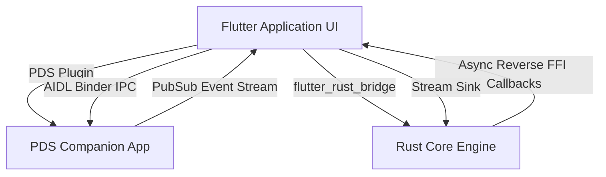

# Architecture and System Design

## 1. System Components

The system has three primary components:

1. **Flutter Application UI**:
   - Gives the user interface on Android.
   - Integrates the Flutter PDS plugin for companion app communication.
   - Passes PDS client callbacks to the Rust engine through `flutter_rust_bridge`.

2. **Rust Core Engine**:
   - Holds accounting models, validation rules, and encryption logic.
   - Executes storage requests by invoking asynchronous reverse FFI callbacks to Dart.
   - Receives PDS real-time events through an incoming stream sink.
   - Generates and schedules analytic processing tasks.
   - Exposes public API methods through `flutter_rust_bridge`.

3. **PDS Companion App (`top.tau2c.pds.core`)**:
   - Manages central data storage and local sync daemons.
   - Communicates with Flutter through Android Binder IPC.
   - Handles user authentication and session key authorization.

## 2. Authentication Flow

- The wallet app does not store the master encryption passphrase.

- The Flutter app requests a session key through the PDS plugin.

- The PDS Companion App requests biometric verification or passcode from the user.

- After positive authentication, the PDS Companion App releases the session key.

- The Flutter app passes the session key to the Rust core for local cryptographic operations.

## 3. Storage Integration and Reverse FFI

- Rust defines an asynchronous storage callback trait for PDS operations (`put`, `get`, `query`, `delete`, `putBlob`, `getBlob`).

- Flutter supplies concrete async callback implementations that route calls to the PDS plugin.

- Rust awaits these callbacks directly to read and write records.

- Rust encrypts financial records before it passes them to the callback.

- Receipt files and metadata pass through without encryption for external project access.

## 4. Real-Time Event Routing

- The Flutter PDS plugin subscribes to change notifications from PDS Core.

- Rust exposes an event stream sink through `flutter_rust_bridge`.

- Flutter forwards raw change event JSON into the Rust stream sink.

- Rust processes the events to update internal caches and invalidate affected analytic aggregates.
